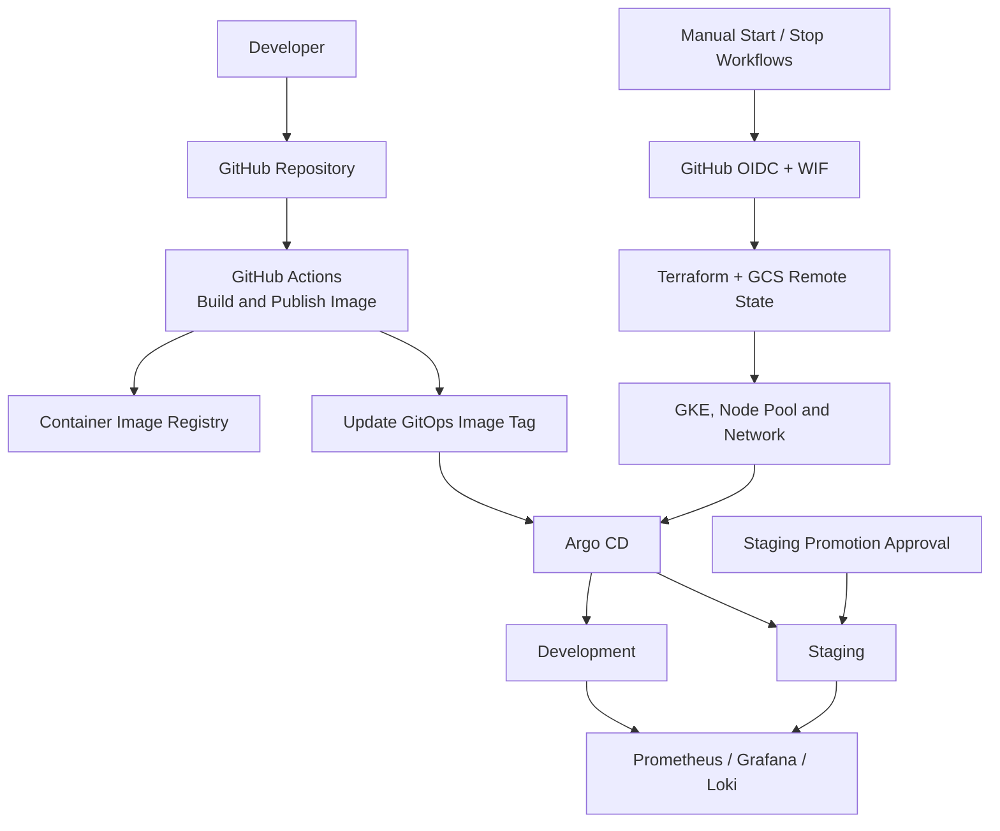

# 🚀 GitOps Incident Simulation

**A cloud-native DevOps project demonstrating GitOps delivery, infrastructure lifecycle automation, controlled staging promotion, and Kubernetes incident observability.**

[](https://www.terraform.io/)
[](https://kubernetes.io/)
[](https://argo-cd.readthedocs.io/)
[](https://docs.github.com/actions)

## 🎯 Overview

GitOps Incident Simulation is a hands-on platform engineering project that brings together application delivery, infrastructure automation, environment promotion, and operational troubleshooting.

The platform combines Terraform-managed Google Kubernetes Engine (GKE), GitHub Actions, Workload Identity Federation (WIF), Argo CD, Helm, and a Prometheus/Grafana/Loki observability stack. Separate development and staging environments demonstrate controlled promotion and environment-specific configuration.

## 🏗️ Architecture



### 🧰 Technology stack

| Area | Technologies |
|---|---|
| Cloud infrastructure | Google Cloud, GKE, VPC, subnet |
| Infrastructure as Code | Terraform, Google Cloud Storage remote state |
| CI/CD and lifecycle automation | GitHub Actions, manual Start/Stop workflows |
| Cloud authentication | GitHub OIDC, Workload Identity Federation, IAM |
| GitOps and packaging | Argo CD ApplicationSet, Helm |
| Application delivery | Docker, SHA-tagged images, container registry |
| Observability | Prometheus, Grafana, Loki, Promtail |
| Incident simulation | Configurable application failure modes |

## ⚙️ Engineering highlights

### 🔄 GitOps delivery and environment promotion

- Git is the source of truth for application deployment configuration; Argo CD reconciles the desired state.
- An Argo CD ApplicationSet manages separate development and staging applications.
- The image workflow builds and publishes a commit-SHA-tagged image and updates the GitOps image tag.
- Staging pins its revision independently and uses a manual approval-gated promotion workflow.
- Promotion validates SHA format and commit ancestry on `main`. It does **not** independently verify development health, test results, or image existence.

### ☁️ Cost-conscious infrastructure lifecycle

- Terraform manages the GKE cluster, node pool, VPC, and subnet.
- A Google Cloud Storage backend keeps Terraform state separate from the runtime infrastructure.
- GitHub Actions authenticates to Google Cloud through OIDC and Workload Identity Federation, avoiding long-lived service-account keys.
- A protected GitHub Environment (`gke-lifecycle`) gates lifecycle operations.
- Persistent bootstrap identity and state resources are separated from disposable runtime infrastructure.

The Start workflow provisions infrastructure, configures Argo CD, creates the Grafana SMTP secret, and applies GitOps and observability resources. It does not wait for every Argo CD application to become healthy.

The Stop workflow destroys the Terraform-managed runtime infrastructure while preserving the remote state bucket and separately managed WIF/IAM bootstrap resources.

See the [Bootstrap IAM and WIF guide](docs/BOOTSTRAP-IAM-WIF.md).

### 🧪 Incident simulation

The demo application supports configurable failure modes:

- `memory-leak`
- `crash-loop`
- `cpu-spike`
- `health-fail`
- `latency`
- Request-triggered crash

These scenarios provide opportunities to investigate application symptoms, Kubernetes health, metrics, logs, and alert behavior. The development `memory-leak` scenario was intentionally used during incident testing.

### 📊 Observability and alerting

- **Prometheus** collects application and infrastructure metrics.
- **Grafana** provides dashboards, alert rules, and notifications.
- **Loki and Promtail** provide centralized log collection.
- Alert rules cover application availability and memory growth.

A verified availability-alert test showed the development alert firing while staging remained normal, and an email notification was received. This confirms that specific test scenario; it does not imply that every alert or failure mode has been tested.

## ✅ Verified results

| Capability | Result |
|---|---|
| Development and staging | Both Argo CD applications were observed Synced and Healthy during validation. |
| Controlled staging promotion | The approval gate was verified: the development revision remained out of staging until approval, then staging updated to the approved revision. |
| Environment isolation | A development-only `memory-leak` configuration change did not automatically change staging before approval. |
| Alerting | The development availability alert fired while staging remained normal; an email notification was received. |
| Infrastructure lifecycle | Start and Stop workflows were successfully exercised, including post-Stop verification. |
| Infrastructure teardown | Terraform reported `Destroy complete! Resources: 4 destroyed`; the cluster, node pool, VPC, and subnet were verified absent. |
| Persistent resources | The GCS state bucket, WIF pool/provider, service account, and bootstrap identity configuration were verified to remain available. |
| Remote Terraform state | Post-Stop verification confirmed the remote state contained no remaining managed resources. |

## 📸 Screenshots

### ☸️ GKE cluster


*GKE cluster and node infrastructure.*

### 📈 Grafana dashboard


*Monitoring dashboard for Kubernetes and application health.*

### 🚨 Grafana alert rules


*Configured alert rules for application availability and memory growth.*

### ✉️ Email alert notification


*Email notification received during availability-alert validation.*

## 📁 Repository layout

```text
.
├── .github/workflows/       # Image build, staging promotion, GKE Start/Stop
├── app/                     # Demo application and failure modes
├── gitops/
│   ├── applicationset.yaml  # Development and staging applications
│   ├── base/                # Shared application configuration
│   └── environments/        # Environment-specific overrides
├── infra/terraform/         # GKE and network lifecycle infrastructure
├── scripts/                 # Local and CI lifecycle helpers
├── docs/
│   ├── BOOTSTRAP-IAM-WIF.md # Learner bootstrap guide
│   └── images/              # Project screenshots
└── README.md
```

## 🚦 Getting started

This repository is intended as a learning and portfolio project. Start with the [Bootstrap IAM and WIF guide](docs/BOOTSTRAP-IAM-WIF.md) to configure your own GCP project, remote Terraform state, federated identity, IAM permissions, and GitHub Environment.

Before running lifecycle workflows, review the Terraform configuration, understand the IAM permissions being granted, and consider the expected cloud costs. Start provisions the runtime infrastructure and configures the platform; verify Argo CD application health separately. Stop removes the Terraform-managed runtime resources while preserving the bootstrap resources.

## 💡 What this project demonstrates

- Infrastructure as Code and remote state management
- Keyless GitHub Actions authentication to Google Cloud
- GitOps reconciliation with Argo CD and Helm
- Controlled promotion between development and staging
- Incident simulation and monitoring-based diagnosis
- Cost-aware creation and teardown of cloud infrastructure

---

## 👤 About the Author

**Parag Joshi**

DevOps Engineer | Cloud | Kubernetes | Terraform | CI/CD

Built this project to demonstrate practical skills in GitOps, infrastructure automation, Kubernetes operations, and observability.
