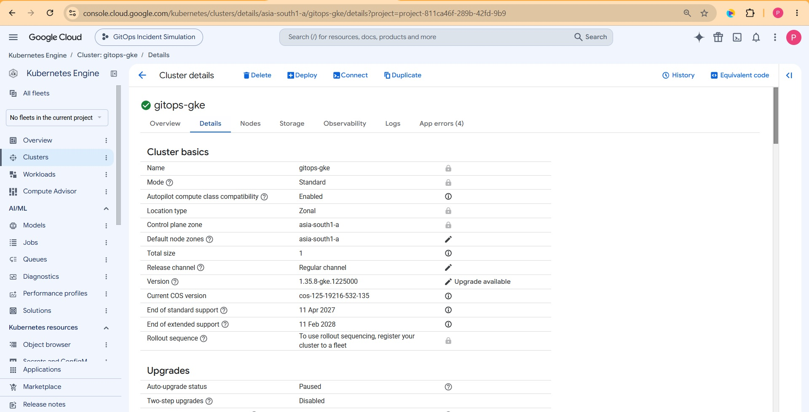
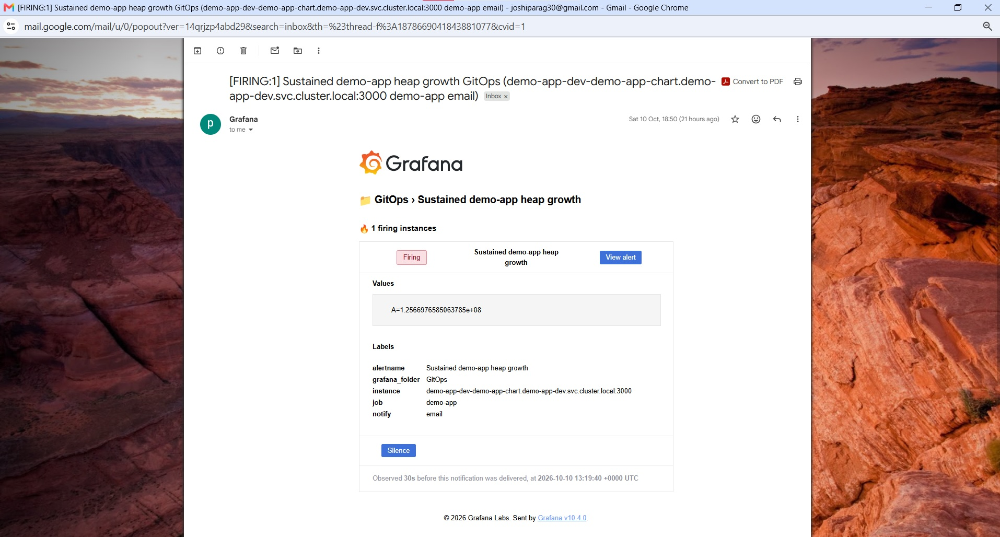

# 🚀 GitOps-Based Incident Simulation & Monitoring System

## 📌 Overview

This project demonstrates how **GitOps, Kubernetes, and observability** tools can be combined to deploy an application, simulate operational failures, and monitor application and cluster health.

The demo application runs on **Google Kubernetes Engine (GKE)**, with **Argo CD** managing deployments from Git. **Prometheus** collects metrics, **Grafana** provides dashboards and alerting, and **Loki with Promtail** centralizes application logs.

The goal is to explore practical DevOps and SRE workflows: managing deployments declaratively, introducing controlled failures, observing their effects, and using metrics, logs, and alerts to investigate application health.


---

## 🏗️ Architecture

```
                GitHub Repository
                        |
             +----------+----------+
             |                     |
             v                     v
       GitHub Actions            Argo CD
       Build & Publish             |
       Container Image             v
             |                 GKE Cluster
             +---------------->    |
                              +-----+------+
                              |            |
                              v            v
                         Demo App     Observability
                        Dev/Staging        |
                              |             |
                    +---------+-------+     |
                    |         |       |     |
                    v         v       v     |
                Prometheus  Promtail  Failure Modes
                    |         |
                    v         v
                 Grafana <--- Loki
                    |
             Dashboards & Alerts
```
Terraform provisions the GKE infrastructure. Argo CD reconciles the application and observability resources from Git, while the monitoring stack provides visibility into cluster metrics, application logs, and configured alert conditions.

---

## What This Project Demonstrates

- **GitOps deployments:** Manage Kubernetes applications and observability components declaratively through Git and Argo CD.
- **Multi-environment deployments:** Run separate dev and staging instances of the demo application using a shared Helm chart.
- **Incident simulation:** Introduce application failures through configurable failure modes and observe their effects.
- **Metrics and dashboards:** Use Prometheus and Grafana to monitor node CPU, node memory, and Prometheus scrape health.
- **Centralized logging:** Use Promtail and Loki to collect pod logs and investigate application behavior through Grafana.
- **Alerting:** Configure Grafana-managed alerts for sustained application heap growth and application availability.
- **Infrastructure lifecycle management:** Use Terraform-backed scripts to provision and destroy the GKE environment, helping control cloud costs.

---

## 🧪 Incident Scenarios

The application supports configurable failure modes to demonstrate different operational symptoms.

| Scenario                | Simulated behavior                                      | What to investigate |
| ----------------------- | ------------------------------------------------------- | --- |
| Memory leak             | Allocates and retains memory periodically.              | Heap growth in Prometheus and Grafana; sustained growth can lead to an OOM kill depending on runtime behavior and the container memory limit. |
| Crash loop              | Exits during startup.                                   | Container restarts, pod status, and application logs. |
| CPU spike               | A request to `/api` triggers a five-second busy loop.   | CPU behavior during the request. No CPU-specific alert is configured. |
| Health check failure    | `/health` returns HTTP 500.                             | Probe failures and application health. |
| Increased latency       | `/api` responses are delayed by three seconds.          | Request behavior and application logs. |
| Request-triggered crash | A request to `/api` terminates the application process. | Pod restarts and logs around the failure. |

These scenarios provide a controlled way to explore how application-level failures appear in Kubernetes and the observability stack. The expected symptoms depend on the specific failure mode and runtime conditions.

---

## 👁️🔔 Observability and Alerting

### 📈 Metrics and dashboards

Prometheus scrapes the demo application in dev and staging, along with node-exporter. Grafana provides a dashboard for:

- Node CPU usage
- Node memory usage
- Prometheus scrape health

### 📄 Logs

Promtail discovers Kubernetes pod logs and forwards them to Loki. Grafana's Loki data source allows logs to be explored by labels such as namespace, making it possible to investigate application startup, requests, and failure-related events.

### 🔔 Grafana-managed alerts

The repository provisions two Grafana alert rules:

- **Sustained demo-app heap growth:** Evaluates heap growth over a 10-minute query window, with a 2-minute pending period.
- **Demo app unavailable:** Detects a dev or staging scrape target reporting down for 2 minutes under the Prometheus `demo-app` job.

A Grafana email contact point and notification policy are also configured. Their configuration does not, by itself, establish successful delivery for every alert scenario.

**Operational note:** In the current setup, changing the alert-provisioning ConfigMap does not automatically restart Grafana or reload the alerting configuration. Manually restart the Grafana deployment after alert-provisioning changes.

## ⚙️ Infrastructure and Delivery

- **Cloud platform:** Google Kubernetes Engine (GKE).
- **Infrastructure as Code:** Terraform provisions the cluster and node pool.
- **Compute:** Spot `e2-standard-2` instances, configured to autoscale from one to two nodes.
- **Deployment management:** Argo CD and Helm.
- **Image pipeline:** GitHub Actions builds and publishes the demo application image and updates the chart image tag on pushes to `main`.
- **Environments:** Dev and staging are configured; production is not implemented.
- **Staging promotion:** Dev follows the image tag updated by GitHub Actions. Staging pins its image tag independently in `gitops/environments/staging/demo-app.yaml`. The `Approve and Promote to Staging` GitHub Actions workflow validates a candidate Git SHA, requires approval through the GitHub `staging` environment, revalidates the SHA, and updates the staging image tag. Argo CD then reconciles staging automatically. The local helper `bash scripts/promote-staging.sh <validated-image-git-sha>` remains available for manual manifest updates but does not invoke the GitHub approval gate. End-to-end promotion validation is pending.
- **Release validation:** Validate the image in dev before promoting it to staging. End-to-end staging promotion validation is pending.
- **Cost control:** `scripts/start-gke.sh` starts the environment, and `scripts/stop-gke.sh` destroys Terraform-managed infrastructure when the environment is no longer needed.

---

## 📸 Screenshots

### GKE Cluster



### Grafana Dashboard on GKE


### Grafana Alert Rules on GKE


### Email Alert



---

## 📂 Repository Structure

```
.
├── .github/workflows/     # Image build and publish workflow
├── app/demo-app/          # Demo application and Dockerfile
├── gitops/
│   ├── base/              # Shared Helm chart
│   └── environments/      # Dev and staging Applications
├── infra/terraform/       # GKE infrastructure
├── observability/
│   ├── grafana/
│   ├── loki/
│   ├── prometheus/
│   └── promtail/
├── scripts/               # GKE start and stop scripts
├── chaos/                 # Placeholder
└── ci-cd/                 # Placeholder

```

---

## 💡 Why This Project Matters

Modern systems are not just about deployment — they are about **resilience and observability**.

This project demonstrates:

* How failures occur in distributed systems
* How to detect them using real-world monitoring tools
* How GitOps ensures consistent and automated recovery

---

## 👨‍💻 Author

**Parag** – Cloud native DevOps Engineer
Specializing in Kubernetes, Terraform, and Observability
